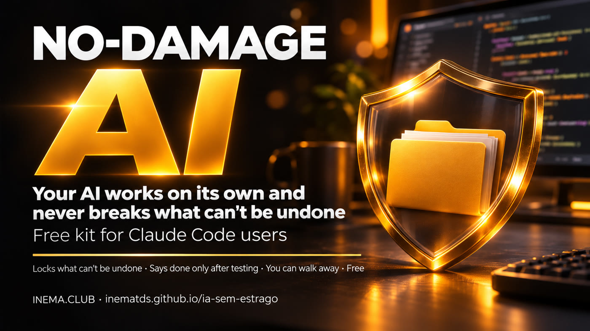

# 🛡️ No-Damage AI

**🇧🇷 [Português](README.md) · 🇺🇸 [English](README.en.md) · 🇪🇸 [Español](README.es.md)**

[](https://inematds.github.io/ia-sem-estrago/guia/en/)

**AI works on its own without damaging anything you can’t undo.** Based on the official Claude Code documentation and recommendations from Anthropic’s engineers. You give it a task and go do something else. When you come back, the task is done and tested. No folders have been deleted, no passwords have been read, and Claude didn’t say “done” before it was ready.

## 📖 Guide

To understand what the kit does and how it changes your day (without the technical details): **https://inematds.github.io/ia-sem-estrago/guia/en/**

🎬 Video (already using Claude Code, in Portuguese): https://www.youtube.com/watch?v=uBUpckFw1Xg  
🎬 Video (just starting, in Portuguese): https://www.youtube.com/watch?v=JBiVZj8z-Ms

## What it is

The kit adds two safeguards to Claude Code:

- **The block:** stops actions that can’t be undone (deleting an entire folder, reading passwords, deleting the project history), in any mode, even if the AI tries. The rule for deciding is one simple question: *“If the AI gets this wrong once, can you undo it?”*
- **The test before “done”:** you define once what “done” means, and a test checks it every time the AI tries to finish. If it fails, the AI goes back and fixes the problem.

With both in place, you can turn off “allow” and walk away. Anything reversible proceeds on its own, in Claude Code’s auto mode.

## Based on Anthropic

None of this is something we made up. The kit brings together, ready to use, what Anthropic (the company behind Claude) publishes and recommends:

- **Claude Code’s engineers:** In the talk “Rethinking Claude Code Best Practices,” Lydia Hallie from the Claude Code team shows how they work: stop watching, block what can’t be undone, and require a test before calling something “done.” That’s how they went from 2,500 to more than 30,000 code changes per day. [Watch](https://www.youtube.com/watch?v=vlfCjWuv4es)
- **Approval fatigue:** People who approve everything by hand end up accepting 93% of requests; Anthropic’s internal log includes real cases of AI deleting git branches, sending an access key outside the organization, and changing the production database. [Article: How we built Claude Code auto mode](https://www.anthropic.com/research/claude-code-auto-mode)
- **The sandbox:** It reduced permission requests by 84%, with greater security. [Article: Making Claude Code safer with sandboxing](https://www.anthropic.com/research/claude-code-sandboxing)
- **Every component in the official documentation:** the block = [Permissions](https://code.claude.com/docs/en/permissions); the sandbox = [Sandbox](https://code.claude.com/docs/en/sandboxing); the test before “done” = [Hooks](https://code.claude.com/docs/en/hooks); how to ask = [Best practices](https://code.claude.com/docs/en/best-practices). Verified on 11/17/2026.

The 14% (people who approve one request at a time) and 89% (auto mode) were shown in the talk; the 93% and 84% are in the official articles.

## How to get started (no technical skills needed)

Open Claude Code or Codex in your project folder and paste:

```text
Read the "No-Damage AI" kit at https://github.com/inematds/ia-sem-estrago (the README explains everything, including installation).
Then look at this project and answer in plain English:
1. What could not be undone if you made a mistake here (deleting things, passwords, sending something outside)?
2. What test or check proves that a task is done in this project?
3. Which parts of the kit would be useful to me, and which would not?
Don’t change anything yet. Show me the plan and wait for me to say yes.
```

The AI shows the plan, you approve what you want, and it installs only that. The kit is designed for Claude Code; Codex can also read it and tell you whether it fits your project.

## What if I open Claude without restrictions?

Many people open Claude Code like this:

```bash
claude --chrome --dangerously-skip-permissions --exclude-dynamic-system-prompt-sections "$@"
```

**The kit still applies.** We tested it on 11/17/2026, with Claude Code 2.1.327 and `--dangerously-skip-permissions`:

| What we asked | What happened |
|---|---|
| read `.env` | **denied** by the block (`Read(./.env)`) |
| `rm -rf lixo` | **denied** by the block; the folder remained |
| say “done” while the check was failing | the hook blocked it 3 times, then let it through (`PRONTO_MAX`) |
| use a tool with an `ask` rule | **asked for confirmation** even in this mode (with `-p`, it becomes a refusal) |

What changes is something else: without restrictions, **the auto mode’s gatekeeper is gone**. In `auto` mode, a second model reviews every action that isn’t blocked and stops anything that looks like damage or an attempt to send something outside. With `--dangerously-skip-permissions`, anything that isn’t blocked goes through. That’s why:

- **Prefer `claude --permission-mode auto`** (the default since 2.1.283). You get the same “doesn’t ask permission” behavior, plus the gatekeeper.
- **If you use Claude without restrictions**, the kit’s block is the only thing between the AI and damage: make sure it’s in the project (`python3 ferramentas/conferir.py .`). Anthropic recommends this mode only in a container or virtual machine.
- **`--chrome` opens the browser**, which is outside the sandbox (the sandbox only encloses terminal commands). Add `ask` rules for connectors and the browser (`kit/exemplos/conectores.json`).
- `--exclude-dynamic-system-prompt-sections` only changes the system text; it doesn’t change any safeguards.

---

## Technical installation

For anyone who prefers to install by hand. Everything is plain text to copy; nothing installs itself.

### Prerequisites

- **Claude Code** with your project open (`claude --version`). Verified with version 2.1.326; `/auto-mode-setup`, `/sandbox`, and `/doctor prompt-audit` were used in that version.
- **Python 3 and git**, for the checker, tests, and downloading the kit.
- **Sandbox on Linux/WSL2:** requires `bubblewrap` and `socat` (`sudo apt install bubblewrap socat`). Nothing needs to be installed on macOS.

### The files

| File | Purpose |
|---|---|
| `kit/.claude/settings.json` | blocking rules (`.env`, `~/.ssh`, forced push, `rm -rf`, `reset --hard`), sandbox enabled, `Stop` and `TaskCompleted` hooks |
| `kit/.claude/hooks/pronto.sh` | runs the check; on failure → exit 2 with the reason; no more than 3 consecutive attempts |
| `kit/teste-do-desfazer.md` | the question that determines what goes on the block list |
| `kit/como-e-pronto.md` | task template with “done means…” and a check for each task |
| `kit/CLAUDE.md.exemplo` | concise CLAUDE.md, with no uppercase IMPORTANT |
| `kit/exemplos/pronto-texto.json` | “done” for text: an `agent`-type `Stop` hook that checks the source for each claim and compares numbers against `dados.csv` |
| `kit/exemplos/conectores.json` | `ask` rules for connectors and browser (send, delete, trash, remove, publish) |
| `ferramentas/conferir.py` | checks a project (CLAUDE.md, block + sandbox, done hook); read-only |
| `exemplo/` | one login in three versions (forgot the old API, logged everyone out, correct) + `PROVA.md` showing the hook running for real |
| `guia/` | the guide page in PT, EN, and ES (GitHub Pages) |

### How it works

`Request with "done means…"` → `Claude works in auto mode` → `block + sandbox stop what can’t be undone` → `Claude tries to stop` → `hook runs the check` → `failed: exits with 2 and tries again · passed: done`

- **Permission order:** `deny` (blocks), `ask` (asks), `allow` (permits). Claude Code checks `deny` first, before the auto mode checker, in every mode, including `bypassPermissions`.
- **The rule checks the command text**, not its effect. That’s why the kit also enables the **sandbox**, where commands can only read folders and connect only to approved sites (`github.com`, `pypi.org`, `files.pythonhosted.org`, `registry.npmjs.org`). If your project connects to another site, add its domain to `sandbox.network.allowedDomains`.
- **Why `Stop` and `TaskCompleted`:** these are the moments when Claude tries to stop or close a task. `PostToolUse` can’t block, even with 2, because the tool has already run.
- **Exit 2, not 1:** with 2, Claude Code returns the error to Claude, which goes back and fixes the problem. With 1, it only shows the error and Claude continues as if the task were done.
- **Loop protection:** `pronto.sh` blocks at most 3 times in a row (`PRONTO_MAX`), then lets Claude stop so you can check.
- **Connectors and browser** (Gmail, Drive, Slack, `--chrome`): the tools are called `mcp__<servidor>__<ação>` (see the names in `/mcp`). The kit suggests `ask`, not `deny`: `ask` keeps requesting confirmation in every mode, including `--dangerously-skip-permissions`, and you can still send the email whenever you want. To prohibit it entirely, move the rule to `deny`. `*` matches any part of the name (`mcp__*__*send*`).
- **The sandbox only encloses terminal commands.** Read/Edit tools and connectors are outside it, which is why the block also covers `~/.ssh`, `.env`, and `secrets/`. On Linux, if you see `Sandbox disabled: ... socat not installed`, the sandbox **is not enabled**: install `bubblewrap` and `socat`.
- **Auto mode allows Claude to read `.env` and send a password to the API it belongs to** (this is Anthropic’s default). If you want the AI to never see the password, you need the `Read(./.env)` block, which the kit already adds.
- **Tell auto mode what belongs to you.** The gatekeeper treats anything it doesn’t recognize as “outside.” List your repositories, buckets, and domains in `autoMode.environment`, **in `~/.claude/settings.json`** (Claude Code ignores `autoMode` in the project’s `.claude/settings.json`, so a repository can’t whitelist itself):
  ```json
  { "autoMode": { "environment": ["$defaults", "Source control: github.com/my-org and all its repos"] } }
  ```
  `$defaults` keeps Anthropic’s rules; `/auto-mode-setup` writes this for you, and `claude auto-mode config` shows the result.
- **Claude Code’s own limit:** after 8 consecutive `Stop` hook blocks, it stops on its own (`CLAUDE_CODE_STOP_HOOK_BLOCK_CAP`). `pronto.sh` stops at 3, before that limit.
- **Where the check comes from**, in this order: the `PRONTO_CMD` variable, the `.claude/pronto.cmd` file (one line), or detection of `npm test` / `python3 -m unittest`. If there is nothing to check, it doesn’t block. If you add a `grep`, make sure the folder exists: `! grep -rn "x" src/` always passes when there is no `src/`.

## The process, start to finish

Replace `~/meu-projeto` with your project folder. ⚙️ = script · 🧠 = you (sometimes with Claude).

| # | Step | Command | Who |
|---|---|---|---|
| 0 | Download the kit | `git clone https://github.com/inematds/ia-sem-estrago.git && cd ia-sem-estrago` | 🧠 you |
| 1 | Check your project (failures the first time are normal) | `python3 ferramentas/conferir.py ~/meu-projeto` | ⚙️ script |
| 2 | Copy the configuration and hook | `cp -rn kit/.claude ~/meu-projeto/` and `echo ".claude/.pronto-bloqueios" >> ~/meu-projeto/.gitignore` (`-n` won’t overwrite anything; if `settings.json` already exists, merge the keys by hand) | 🧠 you |
| 3 | Set the “done” check (for text, add `kit/exemplos/pronto-texto.json`) | `echo "python3 -m unittest discover -s tests -q" > ~/meu-projeto/.claude/pronto.cmd` (replace this with your project’s test) | 🧠 you |
| 4 | Enable auto mode and describe your environment | `claude --permission-mode auto` (or Shift+Tab until “⏵⏵ auto mode on”; default since 2.1.283), then `/auto-mode-setup` | 🧠 you + Claude |
| 5 | Enable and test the sandbox; if you use connectors or `--chrome`, add `kit/exemplos/conectores.json` | `/sandbox` | 🧠 you |
| 6 | Trim down CLAUDE.md | `/doctor prompt-audit` and, for each line, ask: “Would Claude discover this by reading the code?” | 🧠 you + Claude |
| 7 | Check that the hook does its job | `bash exemplo/rodar.sh` (forgot: 2 · logged out: 2 · correct: 0) | ⚙️ script |
| 8 | Check again | step 1 → `ia sem estrago: ok` | ⚙️ script |

The checker reads files; it can’t tell whether you ran steps 4 and 5 inside Claude Code.

## Tests

```bash
python3 -m unittest discover -s tests -v   # 12 tests, only Python 3
bash exemplo/rodar.sh                       # forgot: 2 · logged out: 2 · correct: 0
```

## The proof

The hook ran for real in Claude Code 2.1.326, using the subscription, on 11/17/2026. With a hidden error (the sum was subtracting), Claude said “done”; the hook ran the test, caught the failure, and exited with 2; Claude went back, found the error, fixed it, and only then stopped. Record: `exemplo/PROVA.md`.

## Sources

Talk: “Rethinking Claude Code Best Practices,” by Lydia Hallie (Claude Code team, Anthropic, AI Engineer): https://www.youtube.com/watch?v=vlfCjWuv4es. Syntax checked against the official Claude Code documentation (permissions, sandboxing, hooks, auto mode) on 11/17/2026. The 14% and 89% study was only shown in the talk. A third-party summary of the same talk, which inspired the connector block and the text “done” check: “Anthropic Engineer Explains: The New Way to Use Claude Code,” by Nate Herk (PDF); we checked every item against the documentation before adding it to the kit.

Free at [inema.club](https://inema.club), available online. MIT License.
