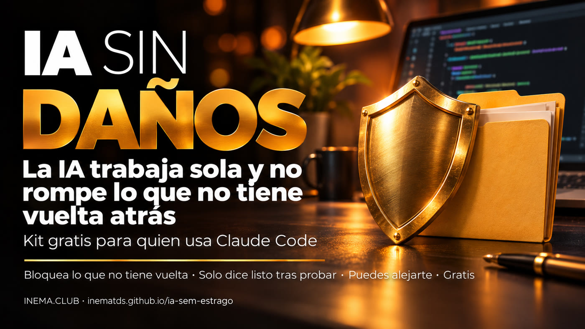

# 🛡️ IA sin daños

**🇧🇷 [Português](README.md) · 🇺🇸 [English](README.en.md) · 🇪🇸 [Español](README.es.md)**

[](https://inematds.github.io/ia-sem-estrago/guia/es/)

**La IA trabaja sola y no estropea lo que no tiene vuelta atrás.** Basado en la documentación oficial de Claude Code y en las recomendaciones de los ingenieros de Anthropic. Le pides la tarea y te ocupas de otra cosa. Cuando vuelves, ya está hecha y probada. No se ha borrado ninguna carpeta, no se ha leído ninguna contraseña y Claude no ha dicho «listo» antes de tiempo.

## 📖 Guía

Para entender qué hace el kit y cómo cambia tu día a día (sin tecnicismos): **https://inematds.github.io/ia-sem-estrago/guia/es/**

🎬 Video (ya usas Claude Code, en portugués): https://www.youtube.com/watch?v=uBUpckFw1Xg  
🎬 Video (estás empezando, en portugués): https://www.youtube.com/watch?v=JBiVZj8z-Ms

## Qué es

El kit añade dos protecciones a Claude Code:

- **El bloqueo:** impide lo irreversible (borrar una carpeta entera, leer contraseñas, borrar el historial del proyecto), en cualquier modo, aunque la IA lo intente. La regla para decidir se resume en una pregunta: *«Si la IA se equivoca una vez al hacer esto, ¿se puede revertir?»*
- **La prueba antes de decir «listo»:** defines una vez qué significa «listo» y una prueba lo comprueba cada vez que la IA intenta terminar. Si falla, vuelve y lo corrige.

Con las dos protecciones, puedes desactivar «permitir» y alejarte. Todo lo que se puede revertir sigue adelante por sí solo, en el modo automático de Claude Code.

## Basado en Anthropic

Nada de esto es invención nuestra. El kit reúne, listo para usar, lo que Anthropic (la empresa que desarrolla Claude) publica y recomienda:

- **Los ingenieros de Claude Code:** en la charla «Rethinking Claude Code Best Practices», Lydia Hallie, del equipo de Claude Code, muestra cómo trabajan: dejan de vigilar, bloquean lo irreversible y exigen una prueba antes de dar algo por «listo». Así pasaron de 2.500 a más de 30.000 cambios de código al día. [Ver](https://www.youtube.com/watch?v=vlfCjWuv4es)
- **El cansancio de aprobar:** quienes aprueban todo a mano terminan aceptando el 93 % de las solicitudes; el registro interno de Anthropic recoge casos reales de IA que borró ramas de git, envió una clave de acceso al exterior y modificó la base de datos de producción. [Artículo: How we built Claude Code auto mode](https://www.anthropic.com/research/claude-code-auto-mode)
- **La caja cerrada (sandbox):** redujo las solicitudes de permiso un 84 %, con más seguridad. [Artículo: Making Claude Code safer with sandboxing](https://www.anthropic.com/research/claude-code-sandboxing)
- **Cada pieza en la documentación oficial:** el bloqueo = [Permisos](https://code.claude.com/docs/en/permissions); la caja cerrada = [Sandbox](https://code.claude.com/docs/en/sandboxing); la prueba antes de decir «listo» = [Hooks](https://code.claude.com/docs/en/hooks); la forma de pedir = [Buenas prácticas](https://code.claude.com/docs/en/best-practices). Verificado el 17/11/2026.

El 14 % (personas que aprueban una cosa a la vez) y el 89 % (modo automático) se mostraron en la charla; el 93 % y el 84 % aparecen en los artículos oficiales.

## Cómo empezar (sin conocimientos técnicos)

Abre Claude Code o Codex en la carpeta de tu proyecto y pega:

```text
Lee el kit «IA sin daños» en https://github.com/inematds/ia-sem-estrago (el README lo explica todo, incluida la instalación).
Después, revisa este proyecto y respóndeme en español sencillo:
1. ¿Qué cosas serían irreversibles si te equivocaras (borrar, contraseñas, enviar algo al exterior)?
2. ¿Qué prueba o comprobación demuestra que una tarea está lista en este proyecto?
3. ¿Qué partes del kit me convienen y cuáles no?
No cambies nada todavía. Muéstrame el plan y espera a que te diga que sí.
```

La IA muestra el plan, tú apruebas lo que quieras y ella instala solo eso. El kit está preparado para Claude Code; Codex también puede leerlo y decirte si sirve para tu proyecto.

## ¿Y si abro Claude sin restricciones?

Mucha gente abre Claude Code así:

```bash
claude --chrome --dangerously-skip-permissions --exclude-dynamic-system-prompt-sections "$@"
```

**El kit sigue siendo útil.** Lo probamos el 17/11/2026 con Claude Code 2.1.327 y `--dangerously-skip-permissions`:

| Lo que pedimos | Lo que ocurrió |
|---|---|
| leer el `.env` | **bloqueado** por la protección (`Read(./.env)`) |
| `rm -rf lixo` | **bloqueado** por la protección; la carpeta siguió allí |
| decir «listo» con la comprobación fallida | el hook lo bloqueó 3 veces y luego lo dejó pasar (`PRONTO_MAX`) |
| usar una herramienta con una regla `ask` | **pidió confirmación** incluso en este modo (con `-p`, se convierte en rechazo) |

Lo que cambia es otra cosa: sin restricciones, **desaparece el portero del modo automático**. En el modo `auto`, un segundo modelo revisa cada acción que no está bloqueada y frena lo que parece un daño o un envío al exterior. Con `--dangerously-skip-permissions`, todo lo que no está bloqueado pasa directamente. Por eso:

- **Prefiere `claude --permission-mode auto`** (es el modo predeterminado desde la versión 2.1.283). Obtienes el mismo «no pide permiso» y conservas el portero.
- **Si vas a usarlo sin restricciones**, la protección del kit es lo único que se interpone entre la IA y el daño: comprueba que esté en el proyecto (`python3 ferramentas/conferir.py .`). Anthropic recomienda este modo solo en un contenedor o una máquina virtual.
- **`--chrome` abre el navegador**, que queda fuera de la caja cerrada (el sandbox solo rodea los comandos de la terminal). Añade una regla `ask` para los conectores y el navegador (`kit/exemplos/conectores.json`).
- `--exclude-dynamic-system-prompt-sections` solo modifica el texto del sistema; no cambia ninguna protección.

---

## Instalación técnica

Para quienes prefieren instalarlo a mano. Todo es texto simple para copiar; nada se instala por sí solo.

### Requisitos previos

- **Claude Code** con tu proyecto abierto (`claude --version`). Probado en la versión 2.1.326; `/auto-mode-setup`, `/sandbox` y `/doctor prompt-audit` se usaron en esa versión.
- **Python 3 y git**, para el verificador, las pruebas y para descargar el kit.
- **Sandbox en Linux/WSL2:** necesita `bubblewrap` y `socat` (`sudo apt install bubblewrap socat`). En macOS no hace falta instalar nada.

### Los archivos

| Archivo | Para qué sirve |
|---|---|
| `kit/.claude/settings.json` | reglas de bloqueo (`.env`, `~/.ssh`, push forzado, `rm -rf`, `reset --hard`), sandbox activado y hooks `Stop` y `TaskCompleted` |
| `kit/.claude/hooks/pronto.sh` | ejecuta la comprobación; si falla → salida 2 con el motivo; como máximo 3 intentos seguidos |
| `kit/teste-do-desfazer.md` | la pregunta que decide qué entra en la lista de bloqueos |
| `kit/como-e-pronto.md` | modelo de solicitud con «listo es…» y una comprobación por tarea |
| `kit/CLAUDE.md.exemplo` | archivo CLAUDE.md breve, sin IMPORTANTES en mayúsculas |
| `kit/exemplos/pronto-texto.json` | «listo» para texto: hook `Stop` de tipo `agent` que comprueba la fuente de cada afirmación y cada cifra frente a `dados.csv` |
| `kit/exemplos/conectores.json` | reglas `ask` para conectores y navegador (enviar, borrar, papelera, quitar, publicar) |
| `ferramentas/conferir.py` | revisa un proyecto (CLAUDE.md, bloqueos + sandbox, hook de «listo»); solo lee |
| `exemplo/` | un inicio de sesión en las tres versiones (olvidó la API anterior, cerró la sesión de todos, correcto) + `PROVA.md` con el hook funcionando de verdad |
| `guia/` | la página de la guía en PT, EN y ES (GitHub Pages) |

### Cómo funciona

`Solicitud con «listo es…»` → `Claude trabaja en modo auto` → `bloqueos + sandbox impiden lo irreversible` → `Claude intenta parar` → `el hook ejecuta la comprobación` → `falló: sale con 2 y vuelve · pasó: listo`

- **Orden de los permisos:** `deny` (bloquea), `ask` (pregunta), `allow` (permite). Claude Code revisa primero `deny`, antes que el verificador del modo auto y en todos los modos, incluido `bypassPermissions`.
- **La regla examina el texto del comando**, no su efecto. Por eso el kit también activa el **sandbox**, donde el comando solo puede leer las carpetas y comunicarse con los sitios permitidos (`github.com`, `pypi.org`, `files.pythonhosted.org`, `registry.npmjs.org`). Si tu proyecto se comunica con otro sitio, añade el dominio a `sandbox.network.allowedDomains`.
- **Por qué `Stop` y `TaskCompleted`:** son los momentos en que Claude intenta parar o cerrar una tarea. `PostToolUse` no bloquea, ni siquiera con 2, porque la herramienta ya se ejecutó.
- **Salida 2, no 1:** con 2, Claude Code devuelve el error a Claude, que vuelve y lo corrige. Con 1, solo muestra el error y Claude sigue como si estuviera hecho.
- **Protección contra bucles:** `pronto.sh` bloquea como máximo 3 veces seguidas (`PRONTO_MAX`) y luego deja parar para que lo revises.
- **Conectores y navegador** (Gmail, Drive, Slack, `--chrome`): las herramientas se llaman `mcp__<servidor>__<acción>` (consulta los nombres en `/mcp`). El kit sugiere `ask`, no `deny`: `ask` sigue pidiendo confirmación en todos los modos, incluido `--dangerously-skip-permissions`, y aun así puedes enviar el correo cuando quieras. Para prohibirlo del todo, cambia la regla a `deny`. `*` sirve en cualquier parte del nombre (`mcp__*__*send*`).
- **La caja cerrada solo rodea los comandos de la terminal.** Las herramientas Read/Edit y los conectores quedan fuera; por eso el bloqueo también cubre `~/.ssh`, `.env` y `secrets/`. En Linux, si aparece `Sandbox disabled: ... socat not installed`, el sandbox **no está activado**: instala `bubblewrap` y `socat`.
- **El modo automático permite leer `.env` y enviar la contraseña a la API a la que pertenece** (es el valor predeterminado de Anthropic). Si quieres que la IA nunca vea la contraseña, necesitas la regla `Read(./.env)`, que el kit ya añade.
- **Dile al modo automático cuáles son tus recursos.** El portero considera «externo» todo lo que no conoce. Enumera tus repositorios, buckets y dominios en `autoMode.environment`, **en `~/.claude/settings.json`** (Claude Code ignora `autoMode` en `.claude/settings.json` del proyecto, para evitar que un repositorio se habilite a sí mismo):
  ```json
  { "autoMode": { "environment": ["$defaults", "Source control: github.com/mi-org y todos sus repos"] } }
  ```
  `$defaults` conserva las reglas de Anthropic; `/auto-mode-setup` lo configura por ti y `claude auto-mode config` muestra el resultado.
- **Límite del propio Claude Code:** después de 8 bloqueos seguidos del hook `Stop`, se detiene por su cuenta (`CLAUDE_CODE_STOP_HOOK_BLOCK_CAP`). `pronto.sh` se detiene tras 3, antes de llegar a ese límite.
- **De dónde sale la comprobación**, en este orden: la variable `PRONTO_CMD`, el archivo `.claude/pronto.cmd` (una línea) o la detección de `npm test` / `python3 -m unittest`. Si no hay nada que comprobar, no bloquea. Si añades un `grep`, comprueba que la carpeta exista: `! grep -rn "x" src/` siempre pasa cuando no hay una carpeta `src/`.

## El proceso, de principio a fin

Cambia `~/meu-projeto` por la carpeta de tu proyecto. ⚙️ = script · 🧠 = tú (a veces con Claude).

| # | Paso | Comando | Quién |
|---|---|---|---|
| 0 | Descargar el kit | `git clone https://github.com/inematds/ia-sem-estrago.git && cd ia-sem-estrago` | 🧠 tú |
| 1 | Revisar tu proyecto (los fallos la primera vez son normales) | `python3 ferramentas/conferir.py ~/meu-projeto` | ⚙️ script |
| 2 | Copiar la configuración y el hook | `cp -rn kit/.claude ~/meu-projeto/` y `echo ".claude/.pronto-bloqueios" >> ~/meu-projeto/.gitignore` (`-n` no sobrescribe; si ya existe `settings.json`, combina las claves a mano) | 🧠 tú |
| 3 | Definir la comprobación de «listo» (para texto: combina `kit/exemplos/pronto-texto.json`) | `echo "python3 -m unittest discover -s tests -q" > ~/meu-projeto/.claude/pronto.cmd` (cámbialo por la prueba de tu proyecto) | 🧠 tú |
| 4 | Activar el modo auto y describir tu entorno | `claude --permission-mode auto` (o pulsa Shift+Tab hasta «⏵⏵ auto mode on»; es el modo predeterminado desde la versión 2.1.283), después `/auto-mode-setup` | 🧠 tú + Claude |
| 5 | Activar y probar el sandbox; si usas conectores o `--chrome`, combinar `kit/exemplos/conectores.json` | `/sandbox` | 🧠 tú |
| 6 | Simplificar el CLAUDE.md | `/doctor prompt-audit` y, para cada línea, pregúntate: «¿Podría descubrirlo leyendo el código?» | 🧠 tú + Claude |
| 7 | Comprobar que el hook exija la prueba | `bash exemplo/rodar.sh` (olvidó: 2 · cerró la sesión: 2 · correcto: 0) | ⚙️ script |
| 8 | Revisar de nuevo | paso 1 → `ia sem estrago: ok` | ⚙️ script |

El verificador lee los archivos; no sabe si ejecutaste los pasos 4 y 5 dentro de Claude Code.

## Pruebas

```bash
python3 -m unittest discover -s tests -v   # 12 pruebas, solo Python 3
bash exemplo/rodar.sh                       # olvidó: 2 · cerró la sesión: 2 · correcto: 0
```

## La prueba

El hook funcionó de verdad en Claude Code 2.1.326, con la suscripción, el 17/11/2026. Con un error oculto (la suma restaba), Claude dijo «listo»; el hook ejecutó la prueba, detectó el fallo y terminó con 2; Claude volvió, encontró el error, lo corrigió y solo entonces se detuvo. Registro: `exemplo/PROVA.md`.

## De dónde viene

Charla «Rethinking Claude Code Best Practices», de Lydia Hallie (equipo de Claude Code, Anthropic, AI Engineer): https://www.youtube.com/watch?v=vlfCjWuv4es. Sintaxis verificada en la documentación oficial de Claude Code (permissions, sandboxing, hooks, auto mode) el 17/11/2026. El estudio del 14 % y el 89 % solo se mostró en la charla. Resumen de terceros de la misma charla, que inspiró el bloqueo de conectores y el «listo» para texto: «Anthropic Engineer Explains: The New Way to Use Claude Code», de Nate Herk (PDF); verificamos cada punto en la documentación antes de incluirlo en el kit.

Gratis en [inema.club](https://inema.club), directamente en internet. Licencia MIT.
